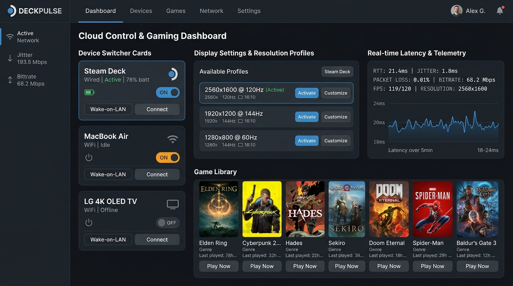
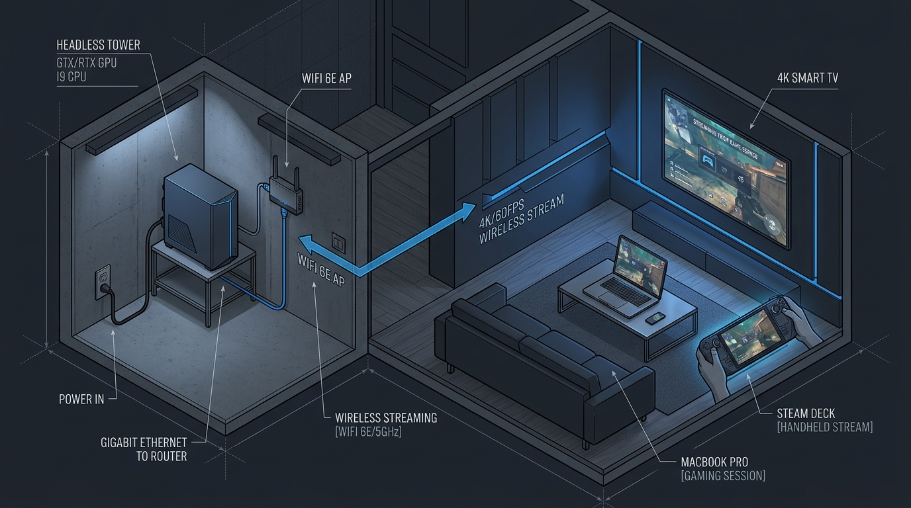

# DeckPulse — Kişisel GeForce NOW, Monitörsüz (Headless) Oyun Kasası & Uzaktan Tünel Kontrol Merkezi

**DeckPulse**, masaüstü oyun bilgisayarınızı (kasanızı) **hiçbir monitör, klavye veya fare bağlamadan** bir odada sadece güç ve Ethernet kablosuyla çalıştırmanızı; ev içindeyken **Steam Deck**, **MacBook** ve **4K Akıllı TV** üzerinden `<1 ms` gecikmeyle, iş yerinde veya farklı bir şehirdeyken ise **tek tuşla uzaktan uyandırarak (Wake-on-LAN)** güvenli P2P tünel üzerinden oynamanızı sağlayan açık kaynaklı bir bulut oyun komuta merkezidir.



---

## Neden DeckPulse? (Çözdüğü Gerçek Sorunlar)

1. **"Sadece Kasa" (Monitörsüz & Faresiz / Headless) Çalışma Modu:**
   - Kasanızı masaya kurmanıza, monitör veya sahte HDMI aparatı (dummy plug) takmanıza gerek yoktur.
   - **Apollo (`SudoVDA`)** sanal ekran sürücüsü sayesinde hangi cihazdan bağlanırsanız o cihazın ekran oranında (`16:10` Steam Deck/MacBook veya `16:9` 4K TV) sanal monitör anında oluşturulur.
   - Windows'ta fiziksel fare takılı olmadığında kaybolan fare imlecini **Sanal HID (`MouseKeys`)** ile kalıcı hale getirir; MacBook Trackpad'iniz veya Steam Deck dokunmatik yüzeyiniz doğrudan kasanın faresi olur.
2. **Windows Kilit Ekranında Takılmaz:**
   - Kasa yeniden başladığında şifre ekranında kalmaması için **Otomatik Oturum Açma (`AutoAdminLogon`)** yapılandırması ve doğrudan web arayüzünden **Kilit Ekranı PIN Gönderici** içerir.
3. **Evde Yerel Ağ (LAN), İş Yerinde Otomatik P2P Tünel (WAN):**
   - Evdeyken tünel kullanmadan doğrudan yerel Gigabit ağ üzerinden (`192.168.1.x`) sıfır gecikmeyle bağlanır.
   - İş yerinde veya dışarıdayken tek tuşla **102-bayt IEEE 802.3 UDP Sihirli Paketi (Wake-on-LAN)** göndererek uyuyan kasayı açar ve güvenli P2P tünel üzerinden bağlanır.



---

## Ekran Görüntüleri ve Özellikler

### 1. Tek Tıkla Cihaz & Sanal Çözünürlük Geçişi
Bağlandığınız cihaza göre Apollo sanal ekranını ve bit hızını tek tıkla değiştirin:
- **Steam Deck (Ev İçi - LAN):** `1280x800 @ 90Hz HDR (16:10)` — Siyah çubuksuz tam ekran (`~0.8 ms`)
- **MacBook Air / Pro (Ev İçi - LAN):** `2560x1600 @ 120Hz HDR (16:10)` — Retina tam ekran + Mac Klavye & Trackpad (`~1.1 ms`)
- **Salon 4K Smart TV (Ev İçi - LAN):** `3840x2160 @ 60Hz HDR (16:9)` — Steam Big Picture konsol modu (`~1.4 ms`)
- **İş Yeri / Uzaktan (P2P Tünel - WAN):** `1280x800 @ 60Hz (AV1 25 Mbps)` — Düşük bant genişliği ve CGNAT aşma (`~8.9 ms`)

### 2. Tarayıcı İçi Canlı Masaüstü (WebRTC) & Sanal Klavye/Fare (KVM)
Moonlight kurulu olmayan bir bilgisayarda veya hızlıca masaüstü ayarı yapmak istediğinizde doğrudan tarayıcı üzerinden kasayı görüntüleyin, **Ctrl+Alt+Del**, **Görev Yöneticisi**, **Steam Big Picture** ve **Sanal Ekran Sıfırlama** kısayollarını tek tıkla gönderin.


### 3. Oyun Kütüphanesi ve Otomatik Başlatıcı
Kütüphanedeki oyunları seçtiğiniz cihaza özel sanal ekran profiliyle doğrudan başlatın:

| Cyber Odyssey 2088 | Nordic Realms Saga | Apex GT3 Motorsport |
| :---: | :---: | :---: |
|  |  |  |

---

## Bu Arayüz Cihazlarınızda Nasıl Görünecek ve Nasıl Kullanılır?

**DeckPulse** iki katmandan oluşur:
1. **Kontrol ve Ayar Arayüzü (Bu Web / Masaüstü Paneli):**
   - Kasanızı uzaktan uyandırmak, çözünürlük/bitrate değiştirmek, Windows kilit ekranı PIN'ini açmak ve oyun başlatmak için kullandığınız komuta merkezidir.
   - Steam Deck kurulum betiğini çalıştırdığınızda Steam Deck masaüstünüze ve uygulama menünüze otomatik olarak **`DeckPulse Kontrol Merkezi`** kısayolu eklenir (Steam'de *Oyun Dışı Uygulama Ekle* diyerek doğrudan **Gaming Mode** içinden de tam ekran açabilirsiniz).
   - MacBook, telefon veya tabletten ise doğrudan tarayıcıdan (veya kasanın yerel adresinden `http://192.168.1.x:3000`) bu arayüze girip tüm ayarları canlı değiştirebilirsiniz.
2. **Yayın Motoru (Apollo + Moonlight & WebRTC):**
   - Oyunları `90Hz / 120Hz HDR` ve `<1 ms` gecikmeyle akıcı oynatan katmandır. DeckPulse arayüzünde yaptığınız her ayar odadaki kasanızla gerçek zamanlı senkronize olur.

---

## Kurulum Rehberi (Adım Adım)

### A) Projeyi Kendi Kasanızda veya Sunucuda Çalıştırma

```bash
# 1. Depoyu klonlayın ve bağımlılıkları yükleyin
git clone <repo-url>
cd deckpulse
npm install

# 2. Geliştirme veya üretim sunucusunu başlatın (Port 3000)
npm run dev
```

Tarayıcınızdan `http://localhost:3000` (veya aynı ağdaki MacBook/Steam Deck'ten `http://<kasa-yerel-ip>:3000`) adresini açın.

### B) Odadaki Oyun Kasası İçin Tek Komutla Kurulum (Windows PowerShell)

Kasanızda **Yönetici (Administrator) PowerShell** penceresini açın ve arayüzdeki **Sadece Kasa Kurulumu** sekmesinde üretilen tek satırlık komutu yapıştırın:

```powershell
irm "http://<sunucu-adresiniz>:3000/api/scripts/host-windows.ps1" | iex
```

**Bu betik otomatik olarak:**
- Kasanın gerçek **Yerel IP**, **MAC Adresi** ve **GPU/CPU** bilgisini bulup DeckPulse arayüzüne kaydeder.
- **Apollo** sanal ekran sunucusu kurulu değilse `winget` ile kurar.
- Fiziksel fare yokken imlecin kaybolmaması için **Windows MouseKeys (Sanal Fare)** özelliğini açar.
- Monitör takılı değilken uykuya geçmeyi engeller ve Ethernet kartında **Wake-on-LAN (Sihirli Paket)** özelliğini aktif eder.
- Gerekli güvenlik duvarı portlarını (`TCP 47984-48010`, `UDP 9, 47998-48010`) açar.

> **İpucu:** Bu betiği çalıştırdıktan sonra kasanızdan monitörü, klavyeyi ve fareyi tamamen söküp kasayı herhangi bir odaya sadece **Güç Kablosu + Ethernet Kablosu** ile koyabilirsiniz.

### C) Steam Deck ve MacBook İçin Tek Komutla Bağlantı

Steam Deck (**Desktop Mode -> Konsole**) veya MacBook (**Terminal**) üzerinde aşağıdaki komutu çalıştırın:

```bash
curl -sL "http://<sunucu-adresiniz>:3000/api/scripts/deck-steamos.sh" | bash
```

**Bu betik otomatik olarak:**
1. Masaüstünüze **DeckPulse Kontrol Merkezi** uygulama kısayolunu ekler.
2. Odadaki kasaya **UDP Sihirli Paket (Wake-on-LAN)** göndererek kasayı uyandırır.
3. Şu an evde mi (`LAN`) yoksa iş yerinde mi (`P2P Tünel`) olduğunuzu otomatik test eder ve en düşük gecikmeli IP üzerinden **Moonlight**'ı başlatır.

---

## Teknik Mimari

```
┌──────────────────────────────────────────────────────────────────────────────┐
│           İstemci Cihazlar (Aile Evi LAN & İş Yeri Uzaktan WAN)              │
│                                                                              │
│  ┌──────────────────┐  ┌──────────────────┐  ┌──────────────┐  ┌──────────┐  │
│  │ Steam Deck OLED  │  │   MacBook Pro    │  │ 4K Smart TV  │  │ İş Yeri  │  │
│  │ 1280x800 @ 90Hz  │  │ 2560x1600 @ 120Hz│  │ 3840x2160@60 │  │ Deck WAN │  │
│  └────────┬─────────┘  └────────┬─────────┘  └──────┬───────┘  └────┬─────┘  │
└───────────┼─────────────────────┼───────────────────┼───────────────┼────────┘
            │                     │                   │               │
            ▼                     ▼                   ▼               ▼
┌──────────────────────────────────────────────────────────────────────────────┐
│                DeckPulse Sunucusu (Express + WebSocket + UDP)                │
│                                                                              │
│  • Gerçek 102-Bayt IEEE 802.3 UDP Sihirli Paket (Wake-on-LAN) Gönderici      │
│  • Otomatik Kasa IP / MAC Keşif ve Kayıt Uç Noktası (/api/agent/register)    │
│  • Gerçek Zamanlı WebSocket Telemetri & Cihaz Profil Senkronizasyonu (/ws)   │
└─────────────────────────────────────────┬────────────────────────────────────┘
                                          │
                                          ▼
┌──────────────────────────────────────────────────────────────────────────────┐
│         Odadaki "Sadece Kasa" Gaming PC (Monitörsüz & Faresiz Host)          │
│                                                                              │
│  • Apollo (SudoVDA Sanal Monitör)  • Sanal HID Fare (MouseKeys)              │
│  • NVENC AV1 / HEVC Donanım Kodlama • Otomatik Windows Oturumu (AutoLogon)   │
└──────────────────────────────────────────────────────────────────────────────┘
```

---

## Lisans

Apache-2.0
